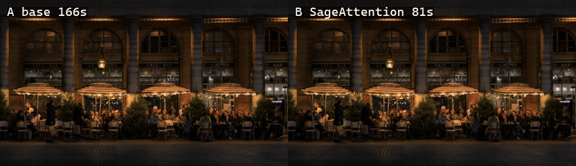
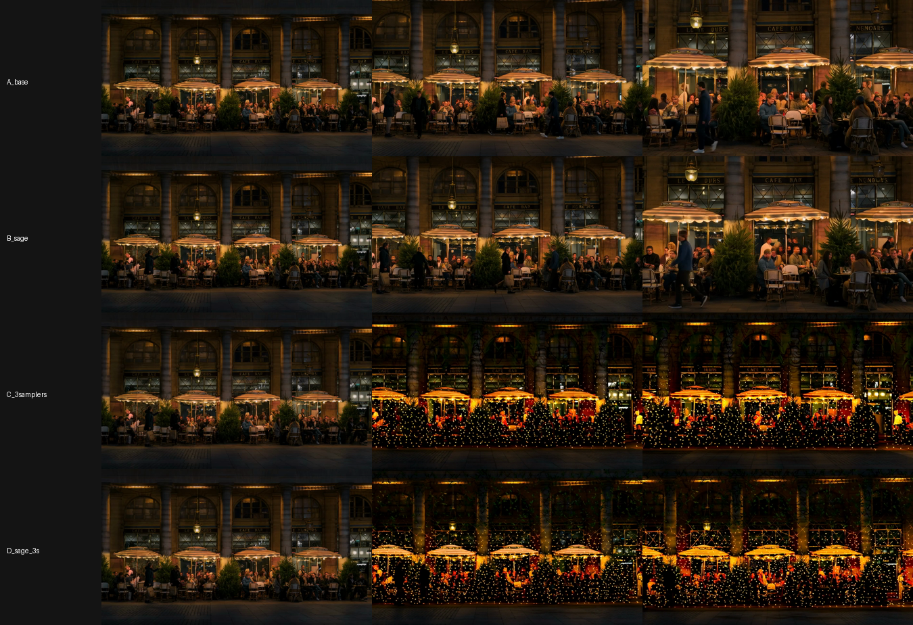

# Casa Brasa: landing con video IA generado en local

Una landing de restaurante que se recorre con el scroll como una película. Es una alternativa gratuita al flujo "Claude Code + Higgsfield": los clips se generan con **Wan 2.2 Image-to-Video 14B** en una **RTX 5060 Ti de 16 GB** propia, usando ComfyUI por Tailscale, sin créditos de ningún servicio.

- Las **escenas de comida** son clips de Wan 2.2 convertidos a una secuencia de frames que se dibuja en un `<canvas>` según el scroll.
- Las **escenas con gente** usan la foto original con movimiento de cámara hecho en código, porque Wan deforma las caras pequeñas. La excepción es la portada, que usa una versión a 720p.

## Benchmark A/B: SageAttention en Wan 2.2

Misma foto, mismo prompt, misma semilla (`424242`), 832×480, 81 frames (unos 5 s a 16 fps). Hardware: RTX 5060 Ti 16 GB, Ryzen 9 7900X, 32 GB de RAM, ComfyUI 0.39 portable, PyTorch 2.14 + CUDA 13.0, modelos fp8_scaled y LoRA lightx2v de 4 pasos. El tiempo se mide desde que el trabajo empieza a ejecutarse, con los modelos ya cargados después de una ronda de calentamiento.

| Variante | Qué cambia | Tiempo | vs. A |
|---|---|---:|---:|
| **A** base | 4 pasos con LoRA lightx2v | **166 s** | — |
| **B** SageAttention | A + SageAttention 2.2 (`PathchSageAttentionKJ`, modo `auto`) | **81 s** | **2,05× más rápido** |
| C 3 samplers | 2 pasos sin LoRA (cfg 3.5) + 4 con LoRA | 239 s | 0,69× |
| D Sage + 3 samplers | C + SageAttention | 144 s | 1,16× |





**Conclusiones**

- **SageAttention reduce el tiempo a la mitad sin perder calidad visible.** La composición, la luz y el detalle quedan iguales que en A. El movimiento de la gente cambia un poco (PSNR de 22,9 dB contra A), porque la atención cuantizada lleva el muestreo por otra trayectoria, no porque se degrade. No aparecieron los frames negros que se reportan en Blackwell.
- **El 2× es mayor que el 30 a 40 % que reportan los foros.** Puede deberse a que con 16 GB la atención pesa más en el tiempo total. Es un único run por variante, así que conviene tomarlo como una estimación.
- **Las variantes C y D fallaron.** En el segundo 2, la escena se convierte en una fachada con luces navideñas que no estaba en la foto. Los parámetros probados (cfg 3.5 sin LoRA en 2 de 6 pasos, shift 5) no sirven. Esto no descarta la técnica de 3 samplers, pero esa configuración no debe usarse.
- **Con caras, la resolución pesa más que el muestreo.** A 720p las caras de la terraza se ven claramente mejor que a 480p ([comparación](benchmark/benchmark_caras_480_vs_720.png)). Sin SageAttention cuesta unas 3 veces más tiempo.

Videos completos: [A_base](benchmark/A_base.mp4) · [B_sage](benchmark/B_sage.mp4) · [C_3samplers](benchmark/C_3samplers.mp4) · [D_sage_3s](benchmark/D_sage_3s.mp4) · [resultados.json](benchmark/resultados.json)

## Estructura

```
index.html          landing (canvas + scroll, sin dependencias)
fotos/              fotos de entrada (Unsplash)
clips/              clips generados con Wan 2.2
frames/             frames WebP que usa la landing + manifest.js
wan_i2v.py          genera un clip: foto + prompt → ComfyUI → mp4
generar_clips.sh    genera los 6 clips
extraer_frames.py   mp4 → frames WebP (requiere imageio-ffmpeg)
benchmark.py        benchmark A/B de variantes de Wan 2.2
```

## Uso

```bash
export COMFY_HOST=http://<ip-de-tu-pc-con-gpu>:8188
python wan_i2v.py fotos/03.jpg "plated dish, slow cinematic push-in" clips 81
python extraer_frames.py
python -m http.server 5173   # abrir http://localhost:5173
```

El servidor de ComfyUI necesita los modelos de [Comfy-Org/Wan_2.2_ComfyUI_Repackaged](https://huggingface.co/Comfy-Org/Wan_2.2_ComfyUI_Repackaged) (I2V high/low noise 14B fp8_scaled, umt5_xxl fp8, wan_2.1_vae y las LoRAs lightx2v de 4 pasos). Para SageAttention necesita además [ComfyUI-KJNodes](https://github.com/kijai/ComfyUI-KJNodes).

## Créditos

Restaurante ficticio. Fotos de [Unsplash](https://unsplash.com) (Licencia Unsplash). Video generado con [Wan 2.2](https://github.com/Wan-Video/Wan2.2) (Apache 2.0).
